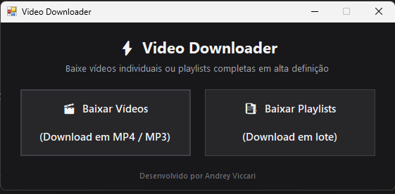
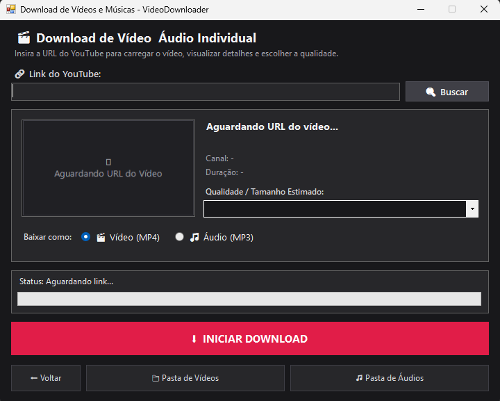
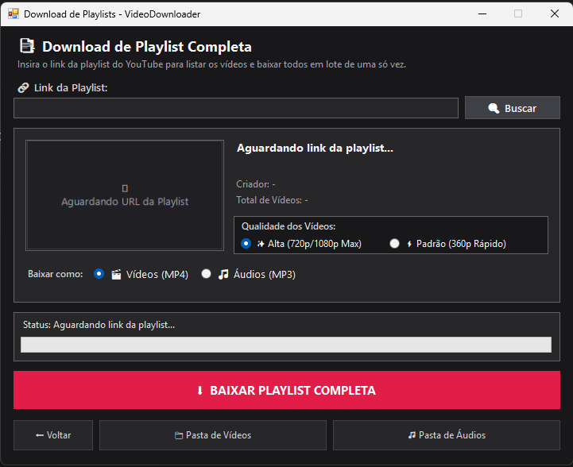

# VideoDownloader

<div align="center">
  <h3>Aplicativo Windows moderno e profissional para download de vídeos, músicas e playlists do YouTube em alta definição.</h3>
</div>

---

## 🌟 Principais Recursos

- **🎬 Download de Vídeos em Alta Definição (MP4):**
  - Suporte a múltiplas resoluções: 1080p, 720p, 480p, 360p (incluindo 60fps).
  - Cálculo automático em tempo real do **tamanho estimado do arquivo** antes do download.
  - Multiplexação direta via FFmpeg garantindo áudio e vídeo sincronizados com alta fidelidade.

- **🎵 Extração de Áudio em MP3 de Alta Qualidade:**
  - Conversão direta para MP3 a **320 kbps** com encoder `libmp3lame`.
  - Download rápido do fluxo nativo de áudio sem re-codificação desnecessária de vídeo.

- **📑 Download de Playlists Completas em Lote:**
  - Baixe todos os vídeos ou músicas de uma playlist com um único clique.
  - Organização automática em pastas nomeadas com o título da playlist.
  - **Download resiliente:** falhas pontuais (como vídeos privados ou restritos) não interrompem o restante da fila.

- **🖼️ Dashboard Interativo & Pré-visualização Instantânea:**
  - Carregamento assíncrono da **Thumbnail em alta resolução**, **Título completo**, **Canal / Criador** e **Duração formatada**.
  - Atalho com a tecla <kbd>Enter</kbd> no campo de URL ou clique em `🔍 Buscar`.
  - Interface moderna com **Dark Theme** elegante e profissional.

- **⚡ Instalação e Configuração Automática do FFmpeg:**
  - O aplicativo verifica se o `ffmpeg.exe` está disponível no sistema ou na pasta do programa.
  - Caso não esteja, oferece download automático da versão estável mais recente via GitHub Releases com barra de progresso e extração automática.

- **📁 Gerenciamento Prático de Arquivos:**
  - Salvamento automático usando os **títulos reais dos vídeos**, com sanitização de caracteres inválidos do Windows.
  - Resolução automática de colisões de nomes (`(1)`, `(2)`, etc.).
  - Atalhos integrados para abrir as pastas de destino (`Vídeos\Baixadas` e `Música\Baixadas`).
  - Ao concluir o download, pergunta se deseja abrir o arquivo diretamente no Windows Explorer.

---

## 📸 Capturas de Tela

### 1. Tela Inicial
Apresentação limpa com acesso rápido às rotinas de download de vídeos ou playlists: 


### 2. Download de Vídeo / Áudio Individual
Dashboard interativo com prévia da capa, dados do canal, duração, seletor de resolução com peso em MB/GB e barra de progresso em tempo real: 


### 3. Download de Playlist Completa
Listagem automática com capa da playlist, criador, contagem total de vídeos e opções de resolução em lote ou modo exclusivo de áudios: 


---

## 💻 Requisitos do Sistema

- **Sistema Operacional:** Windows 10 ou Windows 11 (64-bit recomendado).
- **Runtime:** [.NET Framework 4.8](https://dotnet.microsoft.com/download/dotnet-framework/net48) (já incluído nativamente no Windows 10/11).
- **Conexão com a Internet:** Necessária para buscar dados do YouTube e baixar as mídias.
- **FFmpeg:** Gerenciado e baixado automaticamente pelo próprio aplicativo.

---

## 🚀 Como Compilar o Projeto

1. **Clone o Repositório:**
   ```bash
   git clone https://github.com/Viccari1/VideoDownloader.git
   cd VideoDownloader
   ```

2. **Abra a Solução:**
   - Abra o arquivo `src/VideoDownloader.sln` no **Visual Studio 2022** (qualquer edição: Community, Professional ou Enterprise).

3. **Restauração de Pacotes e Build:**
   - O Visual Studio restaurará automaticamente os pacotes NuGet (`YoutubeExplode`, `CliWrap`, `AngleSharp`, etc.).
   - Pressione <kbd>F5</kbd> ou compile em modo `Debug` ou `Release`.
   - Você também pode compilar diretamente pelo terminal via MSBuild:
     ```powershell
     msbuild src/VideoDownloader.sln /p:Configuration=Release
     ```

---

## 📖 Como Usar

1. **Inicie o programa:**
   - Na primeira execução, se o FFmpeg não estiver presente, o programa perguntará se deseja baixá-lo automaticamente. Basta confirmar e aguardar alguns segundos.
2. **Escolha o tipo de download:**
   - Clique em **🎬 Baixar Vídeos** para um vídeo avulso ou **📑 Baixar Playlists** para uma lista completa.
3. **Cole a URL do YouTube:**
   - Cole o link e pressione <kbd>Enter</kbd> (ou clique em **🔍 Buscar**).
   - As informações do vídeo (ou playlist), capa e resoluções disponíveis serão carregadas na mesma tela.
4. **Escolha o formato e a qualidade:**
   - Selecione entre **Vídeo (MP4)** ou **Áudio (MP3)**.
   - Para vídeos, escolha a resolução desejada na lista (com indicação do peso aproximado em MB/GB).
5. **Clique em Iniciar Download:**
   - Acompanhe a barra de progresso e o status em tempo real.
   - Ao finalizar, confirme a mensagem para abrir a pasta de download já com o arquivo selecionado no Windows Explorer!

---

## 🛠️ Tecnologias e Bibliotecas Utilizadas

- **C# / .NET Framework 4.8:** Plataforma robusta para aplicações desktop no Windows.
- **Windows Forms:** Interface gráfica de alta responsividade com estilização dark theme personalizada.
- **[YoutubeExplode](https://github.com/Tyrrrz/YoutubeExplode):** Extração de metadados, resolução de manifests e download direto de streams do YouTube.
- **[FFmpeg](https://ffmpeg.org/):** Multiplexação de fluxos de vídeo/áudio e conversão para MP3 com codecs `aac` e `libmp3lame`.
- **System.Net.Http com Connection Pooling:** Reúso eficiente de sockets para prévias e downloads de thumbnails sem esgotamento de conexões.

---

## 📄 Licença

Este projeto está licenciado sob a **MIT License com Commons Clause** (consulte o arquivo [LICENSE.md](LICENSE.md) para detalhes), que proíbe o uso comercial do mesmo.

### Bibliotecas de Terceiros:
- **YoutubeExplode:** Licenciado sob a [MIT License](https://github.com/Tyrrrz/YoutubeExplode/blob/master/License.txt).
- **FFmpeg:** Distribuído sob as licenças **GPL / LGPL v2.1+**. Saiba mais em [ffmpeg.org](https://ffmpeg.org/legal.html).
